# JelajahLokal — UTS Web Development

Website direktori wisata lokal Bandung yang menampilkan informasi destinasi, menyediakan halaman detail, login dan registrasi, serta dashboard untuk mengelola destinasi melalui CRUD API.

## Identitas Mahasiswa

- **Nama:** Dafa Irsyad Nashrullah
- **NIM:** 24552011306
- **Kelas:** TIF RP 24 CNS E

## Fitur

### Project 1 — Website

- Halaman utama berisi informasi JelajahLokal dan daftar destinasi.
- Daftar destinasi dimuat dari API; tombol **Lihat detail** membuka detail berdasarkan ID.
- Form login dan registrasi.
- Login admin membuka dashboard, sedangkan login pengguna membuka halaman informasi.
- Dashboard admin untuk melihat, menambah, mengubah, dan menghapus destinasi.
- Tampilan menggunakan Bootstrap 5, Bootstrap Icons, dan CSS khusus.
- Footer pada halaman website: `@Copyright by 24552011306_Dafa Irsyad Nashrullah_TIF RP 24 CNS E`.

### Project 2 — CRUD API

Endpoint utama: `http://localhost/HiddenGems/backend-api/destinasi.php`

| Method | URL | Kegunaan |
|---|---|---|
| GET | `/destinasi.php` | Mengambil semua destinasi |
| GET | `/destinasi.php?id={id}` | Mengambil satu destinasi |
| POST | `/destinasi.php` | Menambahkan destinasi |
| PUT | `/destinasi.php?id={id}` | Memperbarui destinasi |
| DELETE | `/destinasi.php?id={id}` | Menghapus destinasi |

Contoh body JSON untuk **POST**:

```json
{
  "nama_tempat": "Curug Malela",
  "kategori": "Alam",
  "lokasi": "Bandung Barat",
  "deskripsi": "Air terjun yang berada di Bandung Barat.",
  "harga_tiket": 10000,
  "gambar_url": "http://localhost/HiddenGems/frontend/images/curug.jpg"
}
```

Untuk **PUT**, gunakan body dengan semua field di atas dan sertakan `?id={id}` pada URL. Endpoint login dan registrasi masing-masing tersedia di `/backend-api/login.php` dan `/backend-api/register.php`.

## Persyaratan

- Laragon atau lingkungan lokal lain yang menyediakan Apache, PHP 7+, dan MySQL/MariaDB.
- PHP PDO MySQL (`pdo_mysql`) aktif.
- Browser modern; koneksi internet diperlukan untuk memuat Bootstrap dari CDN.
- Bruno atau Postman untuk mencoba API.

## Menjalankan Proyek dan Setup Database

1. Clone atau unduh repository, lalu letakkan folder proyek di `C:\laragon\www\HiddenGems`. Jika menggunakan nama folder berbeda, sesuaikan URL API di frontend.
2. Buka Laragon, lalu jalankan **Apache** dan **MySQL**.
3. Buka phpMyAdmin di `http://localhost/phpmyadmin`.
4. Temukan file dump database berekstensi `.sql` yang tersedia di repository. Import melalui phpMyAdmin:
   - Jika dump sudah berisi perintah untuk membuat database, pilih **Import** dari halaman utama phpMyAdmin dan unggah file tersebut.
   - Jika dump hanya berisi tabel/data, buat database bernama `jelajah_lokal_db`, pilih database itu, lalu buka tab **Import** dan unggah dump SQL.
   - Tunggu sampai phpMyAdmin memberi konfirmasi bahwa import berhasil.
5. Pastikan konfigurasi di `backend-api/koneksi.php` cocok dengan MySQL lokal. Konfigurasi bawaan memakai host `localhost`, database `jelajah_lokal_db`, user `root`, dan password kosong (umum pada Laragon); ubah jika konfigurasi lokal berbeda.
6. Buka `http://localhost/HiddenGems/frontend/index.html` untuk menjalankan website.

Jika API menampilkan pesan koneksi database gagal, pastikan MySQL aktif, database sudah di-import, dan pengaturan di `backend-api/koneksi.php` benar.

### Akun Demo

Akun berikut tersedia sebagai data demo setelah database dari repository berhasil di-import:

| Peran | Email | Password |
|---|---|---|
| Admin | `admin123@gmail.com` | `321123` |
| Pengguna | `yono@gmail.com` | `123456789` |

Masuk melalui `http://localhost/HiddenGems/frontend/login.html`. Akun admin akan diarahkan ke dashboard, sedangkan akun pengguna diarahkan ke halaman informasi.


Endpoint API dapat dicoba menggunakan Bruno/Postman dengan base URL `http://localhost/HiddenGems/backend-api`.

## Screenshot Project 1

### Halaman Utama

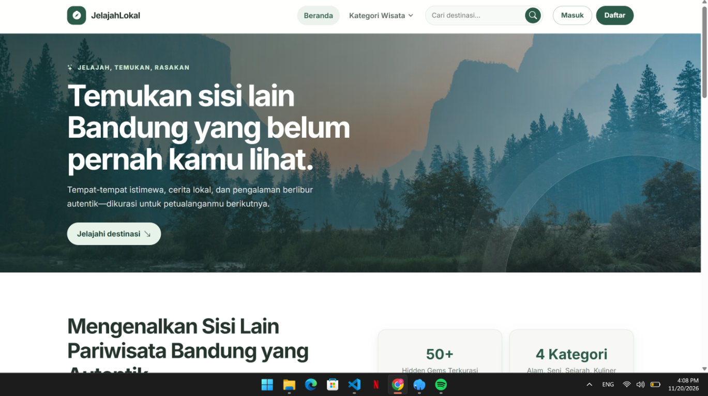

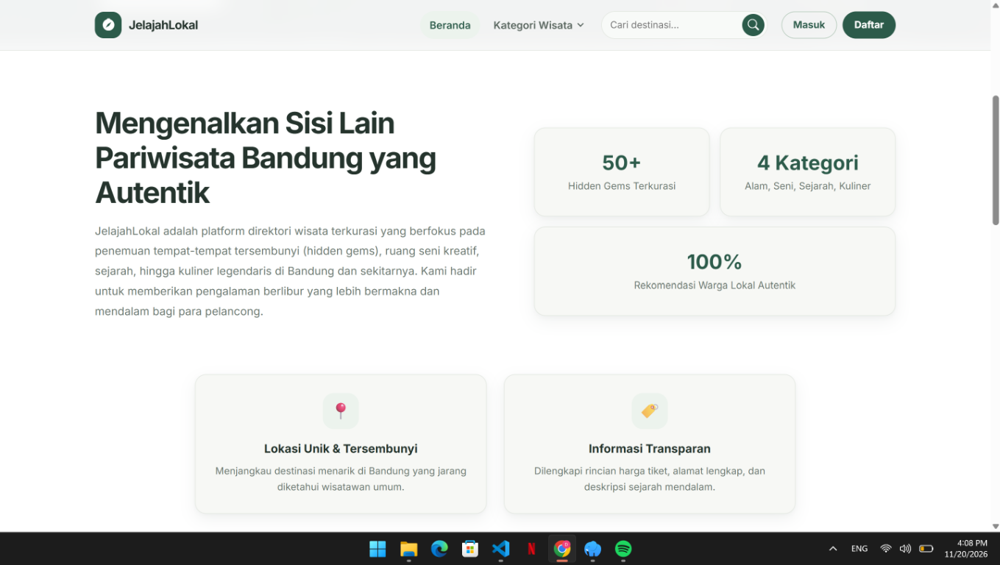


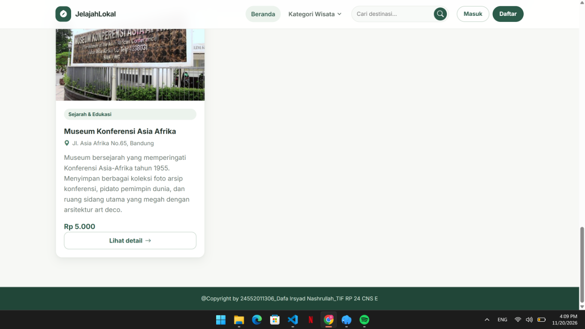

### Login dan Registrasi


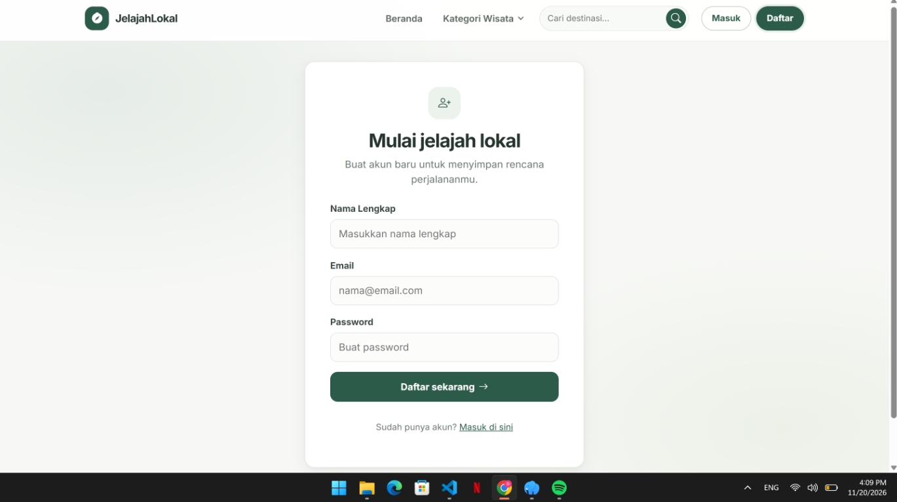

### Detail Destinasi

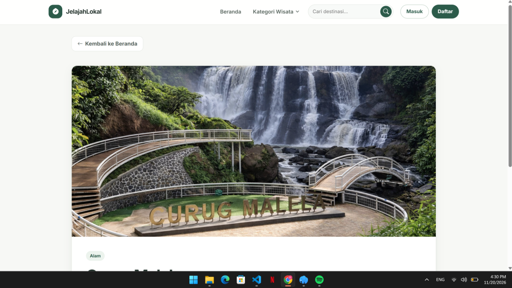

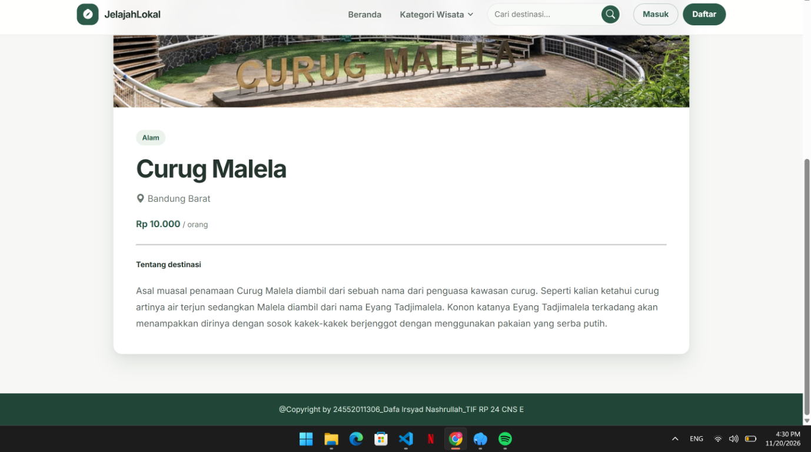

### Dashboard Admin

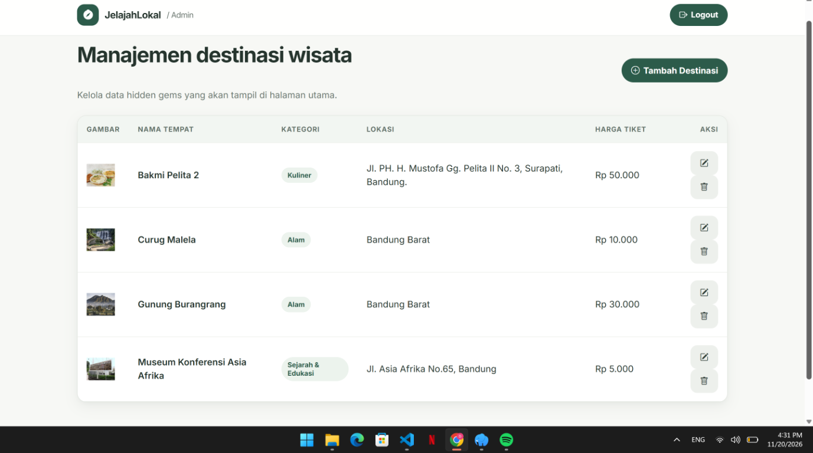

## Screenshot Pengujian API (Bruno)

### GET — Ambil Data

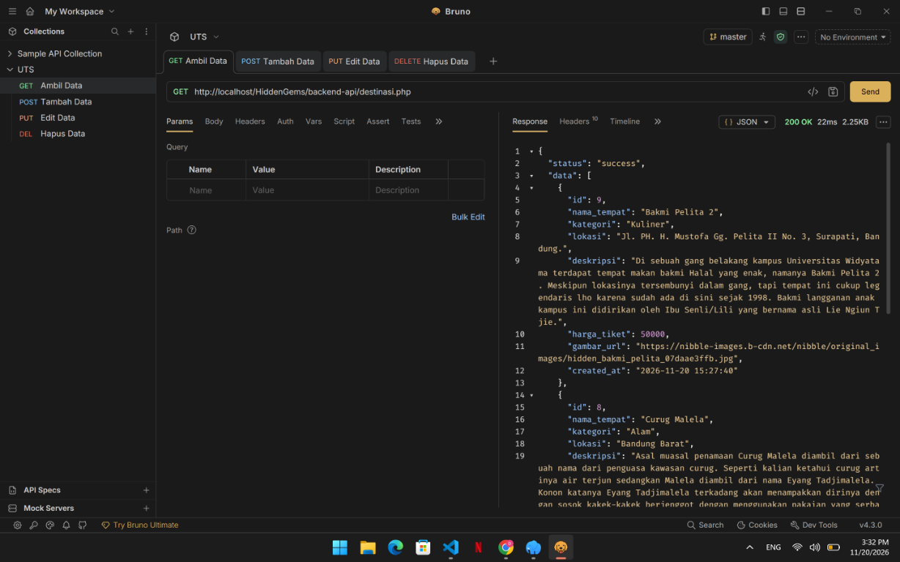

### POST — Tambah Data

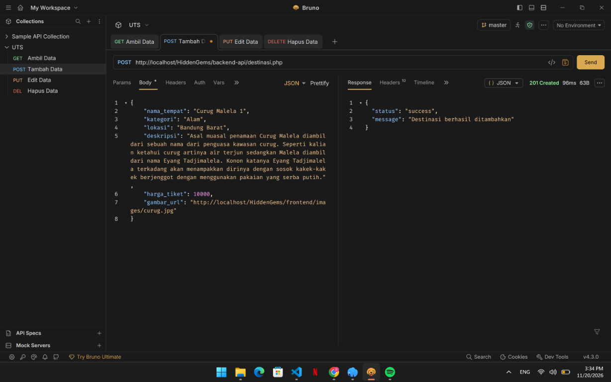

### PUT — Edit Data

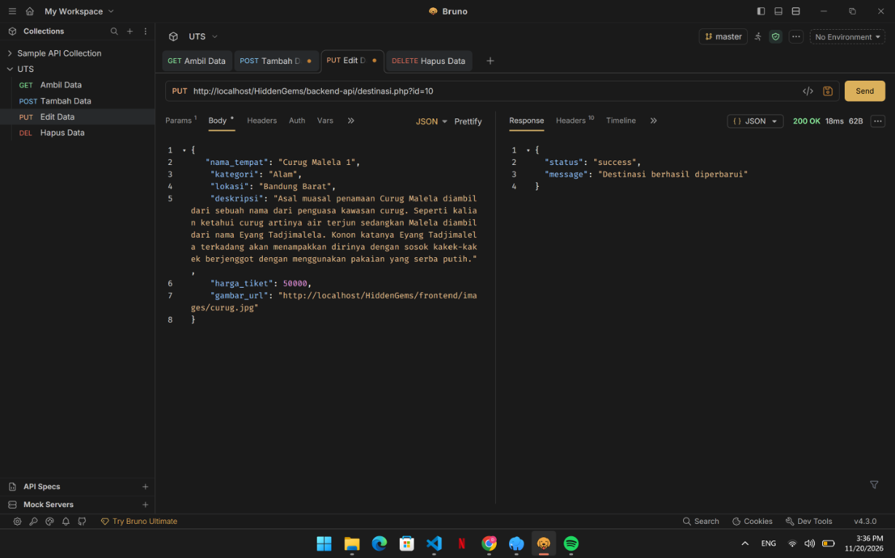

### DELETE — Hapus Data

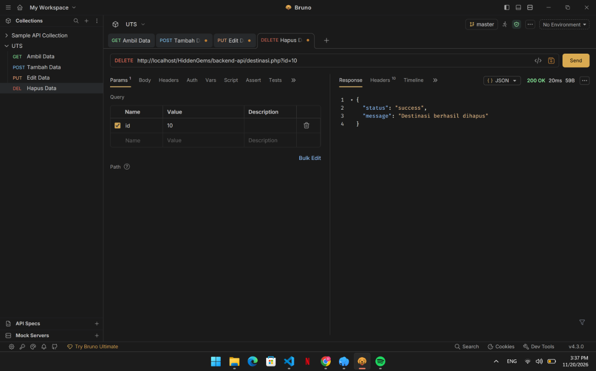

