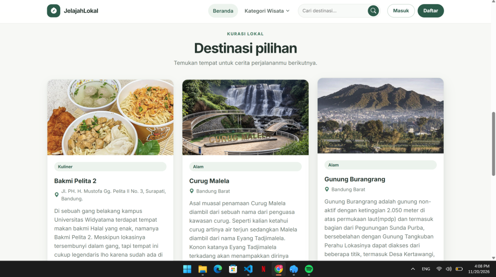
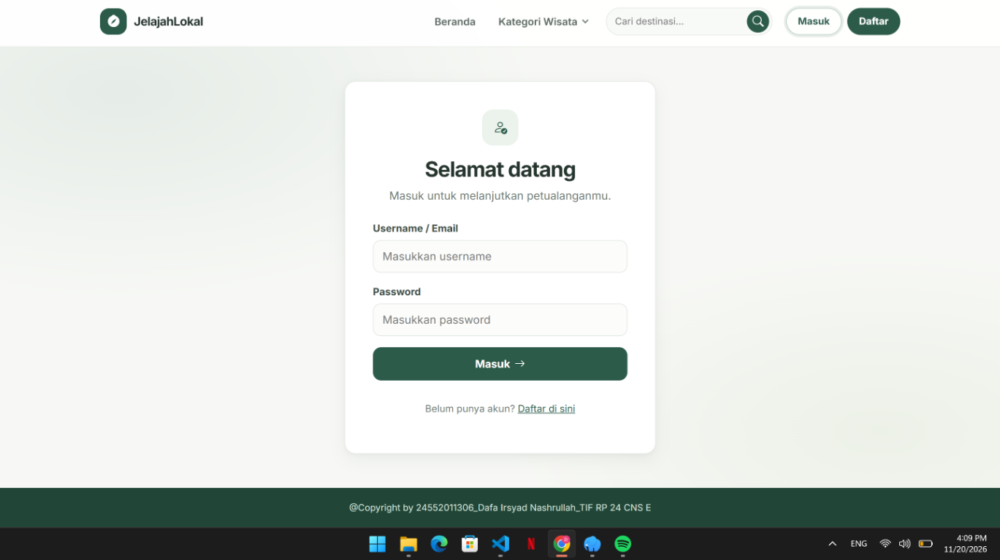

# JelajahLokal — UTS Web Development

Website direktori wisata lokal Bandung yang menampilkan informasi destinasi, menyediakan halaman detail, login dan registrasi, serta dashboard untuk mengelola destinasi melalui CRUD API.

## Identitas Mahasiswa

- **Nama:** Dafa Irsyad Nashrullah
- **NPM:** 24552011306
- **Kelas:** TIF RP 24 CNS E

## Fitur

### Project 1 — Website

- Halaman utama berisi informasi JelajahLokal dan daftar destinasi.
- Daftar destinasi dimuat dari API; tombol **Lihat detail** membuka detail berdasarkan ID.
- Form login dan registrasi.
- Login admin membuka dashboard, sedangkan login pengguna membuka halaman informasi.
- Dashboard admin untuk melihat, menambah, mengubah, dan menghapus destinasi.
- Tampilan menggunakan Bootstrap 5, Bootstrap Icons, dan CSS khusus.
- Footer pada halaman website: `@Copyright by 24552011306_Dafa Irsyad Nashrullah_TIF RP 24 CNS E`.

### Project 2 — CRUD API

Endpoint utama: `http://localhost/HiddenGems/backend-api/destinasi.php`

| Method | URL | Kegunaan |
|---|---|---|
| GET | `/destinasi.php` | Mengambil semua destinasi |
| GET | `/destinasi.php?id={id}` | Mengambil satu destinasi |
| POST | `/destinasi.php` | Menambahkan destinasi |
| PUT | `/destinasi.php?id={id}` | Memperbarui destinasi |
| DELETE | `/destinasi.php?id={id}` | Menghapus destinasi |

Contoh body JSON untuk **POST**:

```json
{
  "nama_tempat": "Curug Malela",
  "kategori": "Alam",
  "lokasi": "Bandung Barat",
  "deskripsi": "Air terjun yang berada di Bandung Barat.",
  "harga_tiket": 10000,
  "gambar_url": "http://localhost/HiddenGems/frontend/images/curug.jpg"
}
```

Untuk **PUT**, gunakan body dengan semua field di atas dan sertakan `?id={id}` pada URL. Endpoint login dan registrasi masing-masing tersedia di `/backend-api/login.php` dan `/backend-api/register.php`.

## Persyaratan

- Laragon atau lingkungan lokal lain yang menyediakan Apache, PHP 7+, dan MySQL/MariaDB.
- PHP PDO MySQL (`pdo_mysql`) aktif.
- Browser modern; koneksi internet diperlukan untuk memuat Bootstrap dari CDN.
- Bruno atau Postman untuk mencoba API.


Endpoint API dapat dicoba menggunakan Bruno/Postman dengan base URL `http://localhost/HiddenGems/backend-api`.

## Screenshot Project 1

### Halaman Utama





### Login dan Registrasi




### Detail Destinasi


### Dashboard Admin


## Screenshot Pengujian API (Bruno)

### GET — Ambil Data


### POST — Tambah Data


### PUT — Edit Data


### DELETE — Hapus Data


## Catatan


